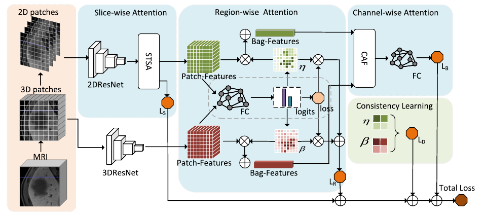
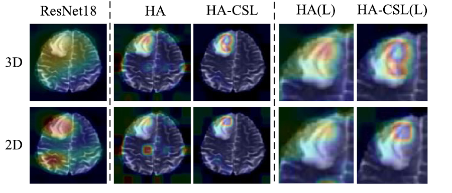

# HA-CSL

### Interpretable 2.5D Network by Hierarchical Attention and Consistency Learning for 3D MRI Classification

Official PyTorch implementation of **HA-CSL**, published in *Pattern Recognition*, Volume 164, 2025, Article 111539.

**Shuting Pang\***, **Yidi Chen\***, Xiaoshuang Shi, Rui Wang, Mingzhe Dai, Xiaofeng Zhu, Bin Song, and Kang Li.  
\* Equal contribution.

[Paper](https://doi.org/10.1016/j.patcog.2025.111539) · [HCC dataset](https://huggingface.co/datasets/Shuting2024/HCC_West_China_Hospital) · [Method](#method) · [Results](#results-reported-in-the-paper) · [Usage](#getting-started) · [Citation](#citation)

HA-CSL combines **2D patch detail and 3D spatial context** for MRI classification. Its hierarchical attention identifies informative slices, regions, and feature channels, while consistency learning encourages the two branches to attend to corresponding regions.



*Overall architecture, reproduced from Figure 1 of the paper. A 2D branch and a 3D branch are connected by hierarchical attention and attention consistency learning.*

## Method

Each MRI volume is treated as a **bag**, and its patches are the **instances**. Classification uses volume-level labels; individual patches do not require class annotations. The HCC preprocessing described in the paper does use a roughly annotated lesion ROI to crop the input.

| Component | Purpose |
| --- | --- |
| **2D / 3D branches** | ResNet18-based encoders extract slice-level patch detail and local volumetric features, respectively. |
| **STSA: slice-wise tandem sparse attention** | Identify informative slices and aggregate their features in the 2D branch. |
| **RA: region-wise shared attention** | Weight corresponding regions from both branches, linking attention and classification through shared classifier parameters. |
| **CAF: channel attention fusion** | Weight and combine the two branches' feature channels before the final prediction. |
| **CSL: consistency learning** | Align the branches' region attention distributions through temperature-scaled KL divergence. |

The paper's objective combines image classification, slice attention, region attention, and attention consistency:

$$
\mathcal{L} = \mathcal{L}_B + \gamma_1(\tau)\mathcal{L}_S + \gamma_2(\tau)\mathcal{L}_R + \gamma_3(\tau)\mathcal{L}_D.
$$

See Sections 3.2–3.4 of the paper for details.

## Results reported in the paper

Five-fold cross-validation results (mean ± standard deviation), reported in Tables 2 and 3 of the paper.

| Dataset | Prediction task | Patients | ACC | F1 | AUC | Sensitivity | Specificity |
| --- | --- | ---: | ---: | ---: | ---: | ---: | ---: |
| **HCC** | Microvascular invasion (MVI), HBP MRI | 246 | 0.901 ± 0.064 | 0.892 ± 0.056 | 0.926 ± 0.048 | 0.909 ± 0.062 | 0.887 ± 0.045 |
| **BraTS21** | MGMT promoter methylation, T2 MRI | 585 | 0.631 ± 0.030 | 0.694 ± 0.038 | 0.622 ± 0.032 | 0.797 ± 0.076 | 0.443 ± 0.059 |

The paper also reports component ablations in Table 5 and interpretability experiments in Section 4.6.

## Interpretability



*Qualitative results reproduced from Figure 4 of the paper, on BraTS21. The rows show the 3D and 2D branches. Columns compare ResNet18, hierarchical attention (HA), and HA-CSL; “(L)” denotes enlarged regions. Section 4.6 describes combining CAM with region attention and overlaying the maps on MRI images.*

HA-CSL highlights informative regions and encourages consistent attention between the 2D and 3D branches. The model also returns region attention weights for further analysis.

## Repository guide

| File / directory | Role |
| --- | --- |
| [`model.py`](model.py) | Sparse attention, the 2D branch, and dual-branch model variants. |
| [`main_attention.py`](main_attention.py) | Argument parsing, data preparation, five-fold training, validation, logging, and checkpoint saving. |
| [`dataloader.py`](dataloader.py) | `BagsROI2`: load ROI crops and apply transforms. |
| [`trans.py`](trans.py) | ROI cropping, resizing, resampling helpers, and joint shuffling. |
| [`weight_loss.py`](weight_loss.py) | Instance-weighted cross-entropy. |
| [`metric_helpper.py`](metric_helpper.py) | Classification metric helpers. |
| [`data/`](data/) | Dataset reference; MRI volumes are not bundled. |
| [`checkpoint/`](checkpoint/) | Placeholder directory; trained model weights are not bundled. |
| [`docs/assets/`](docs/assets/) | The paper figures used in this README. |

### Model variants

| `--case` | Implementation | Behavior |
| --- | --- | --- |
| `resnet` | MONAI 3D ResNet18 | Whole-volume baseline. |
| `MP` | `LossAttention2D1` | 2D patch branch with hierarchical attention. |
| `MIX` | `MixMoudle2` | Average the predictions from the two branches. |
| `ADD` | `MixMoudle_Add` | Fuse branch features, with optional channel attention. |

For `ADD`, `--CA_case 0` adds the branch features; `1` weights each branch before addition; `2` weights the summed features; `3` jointly weights concatenated features before splitting and adding them. `--choice` selects `base`, `distill`, `mse`, or `sim` for the training objective.

## Getting started

### Environment

```bash
git clone https://github.com/shuting-pang/HA_CSL.git
cd HA_CSL
```

Dependencies: **PyTorch, torchvision, MONAI, einops, NumPy, SciPy, scikit-learn, SimpleITK, scikit-image, OpenCV, Matplotlib, seaborn, TensorBoard, and xlwt**. The paper uses MONAI 0.9.0; use compatible versions of NumPy and SciPy for the legacy APIs in these research scripts.

### Data preparation

The HCC dataset is linked at [Shuting2024/HCC_West_China_Hospital](https://huggingface.co/datasets/Shuting2024/HCC_West_China_Hospital). For BraTS21, obtain the radiogenomic classification data and labels from the dataset's official distribution. The released training entry point is configured for the HCC directory layout; it does not include a separate BraTS21 loader.

The current HCC loader expects paired MRI and ROI files, grouped into `old` and `new` folders:

```text
HBP-feature/HBP-feature/
├── old/0011.nii.gz
└── new/0020.nii.gz
HBP-ROI/HBP-ROI/
├── old/0011.nii
└── new/0020.nii
```

These filenames are illustrative. Keep numeric filenames compatible with the sorting rule in `get()`. The current code assigns label **1** to ROI filenames ending in `1.nii` and **0** to other filenames; verify the clinical meaning of this encoding against your dataset labels.

Before training, adapt these locations in the source:

1. `main_attention.py`: the two ROI roots and `feature_root` in `get()`.
2. `trans.py`: `mask_name` and the filename mapping in `GetRoi2()`. The mapping currently uses a fixed string offset, `sample_name[38:-3]`, and must be updated when the directory layout changes.
3. `main_attention.py`: the fixed GPU selection, `CUDA_VISIBLE_DEVICES="1"`, to match the available hardware. Some training tensors also use `.cuda()` directly.

`BagsROI2` calls `GetRoi2()` and transforms each crop into a model input with layout **`[B, 1, 10, 128, 128]`**. With 16 × 16 patches, the 128 × 128 plane contains **64 regions**.

### Model interface

A randomly initialized forward pass can inspect the model outputs without loading the HCC dataset. It requires the model dependencies above; it does not measure classification performance.

```python
import torch
from model import MixMoudle_Add

model = MixMoudle_Add(patchsize=16, reduction_ratio=16).eval()
x = torch.randn(1, 1, 10, 128, 128)

with torch.no_grad():
    logits_2d, patch_logits_2d, attention_2d, \
        logits_3d, patch_logits_3d, attention_3d, logits = model(
            x, shared=1, CA_case=3
        )

# logits: [B, 2]; each region attention: [B, 64]
# Class probabilities are obtained with torch.softmax(logits, dim=1).
```

### Training and outputs

After adapting the data paths, GPU selection, and environment, this command selects dual-branch fusion, shared classification parameters, joint channel attention, and the KL-based consistency option:

```bash
python main_attention.py \
  --case ADD --shared 1 --CA_case 3 --choice distill \
  --epochs 100 --bs 16 --lr 1e-4 --reg 1e-4 \
  --Temp 0.7 --sigma 10 --seed 2022 \
  --file_path ./runs/ha_csl
```

`--choice distill` enables the KL-based attention consistency loss.

The script runs `StratifiedKFold(n_splits=5, shuffle=True, random_state=0)` and saves:

- `log.txt`: arguments, epoch metrics, selected epochs, and fold summaries.
- TensorBoard event files: loss, classification metrics, and learning rate by fold.
- `model1.pth` … `model5.pth`: checkpoints selected by the highest validation accuracy in each fold, containing model and optimizer state dictionaries.

## Citation

```bibtex
@article{pang2025hacsl,
  title   = {Interpretable 2.5D network by hierarchical attention and consistency learning for 3D MRI classification},
  author  = {Pang, Shuting and Chen, Yidi and Shi, Xiaoshuang and Wang, Rui and Dai, Mingzhe and Zhu, Xiaofeng and Song, Bin and Li, Kang},
  journal = {Pattern Recognition},
  volume  = {164},
  pages   = {111539},
  year    = {2025},
  doi     = {10.1016/j.patcog.2025.111539}
}
```
